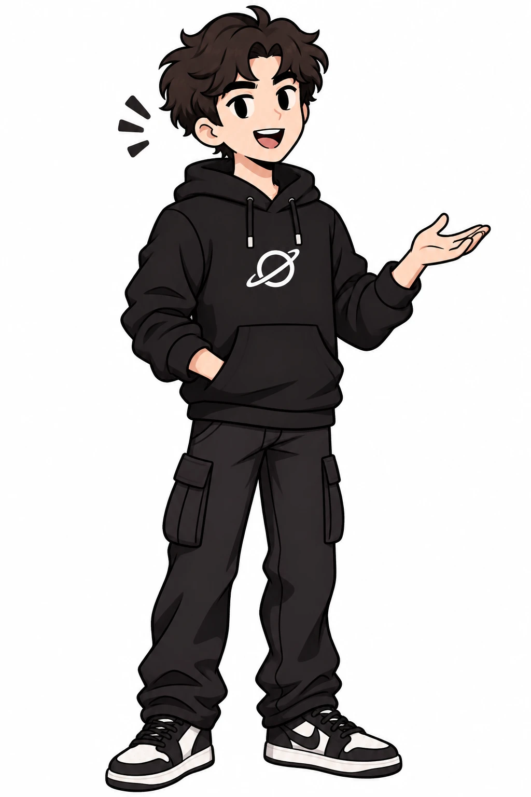

# Personaje 0

Narrador principal del canal **Otro Contexto** (@OtroContextoYT).
Cuando el creador diga "personaje 0", se refiere a él.

## Quién es
- Chico joven, mexicano.
- Narra todas las historias, tanto en videos largos como en Shorts.
- No tiene nombre: el protagonista de cada video es la historia, no él.

## Aspecto
Ilustración 2D, trazo grueso, colores planos.
- Pelo castaño oscuro, rizado y despeinado; ojos negros; sonrisa abierta.
- Sudadera negra con capucha y logo blanco de un planeta con anillo al centro.
- Pantalón cargo negro, tenis bajos negro con blanco.
- **Pose variable**: no repite siempre la misma. La pose de la imagen (mano en el bolsillo,
  palma abierta presentando) es solo una de muchas; cada escena pide la pose que acompañe lo que dice.
- Líneas de énfasis junto a la cabeza cuando dice algo importante.

## Cómo habla
- Español **neutro**: sin modismos de ningún país o región.
- Muy expresivo: hace notar cada palabra. Frases cortas que se puedan remarcar.
- **Humor ligero**: comentarios rápidos que sacan una sonrisa, sin interrumpir la historia.
- Le habla de tú a quien ve, cercano.

## Estructura fija
- **Bienvenida informal** en cada video: corta, cercana, nada de "bienvenidos a mi canal, hoy les traigo".
  Va justo después de la primera frase gancho, para no perder a la gente en los primeros segundos.
  En Shorts, la bienvenida es de una o dos palabras, pegada al gancho.
- **Cierre**: invitación a seguir el canal para más datos, historias o curiosidades.
  La idea es siempre la misma, pero la frase cambia en cada video y se adapta a la historia que se contó.

## Cómo se marcan los guiones
- Palabras a remarcar: MAYÚSCULAS.
- Pausas: "..."
- Tono, gesto o pose: entre [corchetes].

## Reglas
- Nunca inventar cifras, fechas ni fuentes. Si un dato no está verificado, no se dice.
